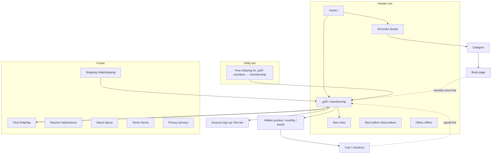

# Site Architecture — آفاق الفكر (Salla store)

> Scope: where the membership page (`آفاق+`) sits in the store, how people reach it, and how it links back into the catalogue.
> Inputs: `tasks/prd-membership-page.md`, `docs/brand-guidelines.md`.
> Status: Draft v1, 2026-11-26.

## Assumptions (verify)

| # | Assumption | Why it matters |
|---|------------|----------------|
| A1 | Existing Salla store; this adds a section, it is not a rebuild | No redirects needed except for any old membership/loyalty page |
| A2 | Site type: e-commerce (books), Arabic, RTL | Hierarchy depth 3 levels |
| A3 | Category names below are placeholders | Replace with the store's real categories |
| A4 | Salla generates product and category URLs (often with an ID suffix) | We control slugs for custom pages only; confirm the exact pattern in the Salla dashboard |
| A5 | The membership product is a hidden product, reachable only from `/membership` | Keeps it out of the book grid and category pages |

---

## 1. Page Hierarchy

```
Homepage (/)
├── Shop / All books (/books)
│   ├── [Category] Psychology (/books/psychology)
│   ├── [Category] Self-development (/books/self-development)
│   ├── [Category] Business (/books/business)
│   ├── [Category] Thought & philosophy (/books/philosophy)
│   └── [Category] Novels (/books/novels)
│       └── [Book] (Salla product URL)
├── New releases (/new)
├── Best sellers (/best-sellers)
├── Offers (/offers)
├── Membership — آفاق+ (/membership)            ← NEW, L1
│   └── [Hidden product] آفاق+ monthly / yearly (Salla product URL → cart)
├── Help (/help)
│   ├── FAQ (/help/faq)                          ← add membership questions
│   ├── Shipping (/help/shipping)                ← mention member free shipping
│   └── Returns & cancellations (/help/returns)  ← add membership cancellation policy
├── Account (/account)                           ← Salla account; free tier sign-up lands here
├── Cart (/cart)
├── About (/about)
├── Contact (/contact)
├── Privacy (/privacy)
└── Terms (/terms)                               ← add membership terms
```

**Why L1 for membership:** it is a store-wide offer that touches every purchase (discount + shipping), so it sits one click from every page. Burying it under Help or Account would hide the only recurring-revenue product.

**Depth check (3-click rule):** Home → Category → Book = 2 clicks. Home → Membership → Checkout = 2 clicks. Pass.

---

## 2. Visual Sitemap



---

## 3. URL Map

| Page | URL | Parent | Nav location | Priority |
|------|-----|--------|--------------|----------|
| Homepage | `/` | — | Header (wordmark) | Critical |
| All books | `/books` | Home | Header | Critical |
| Category | `/books/{category}` | All books | Header dropdown | High |
| Book | Salla product URL | Category | — | High |
| New releases | `/new` | Home | Header | High |
| Best sellers | `/best-sellers` | Home | Header | High |
| Offers | `/offers` | Home | Header | Medium |
| **Membership (آفاق+)** | **`/membership`** | Home | **Header (last item) + utility bar + footer** | **High** |
| Membership product | Salla product URL (hidden) | Membership | — | High |
| Account | `/account` | Home | Header icon | Medium |
| FAQ | `/help/faq` | Help | Footer | Medium |
| Shipping | `/help/shipping` | Help | Footer | Medium |
| Returns & cancellations | `/help/returns` | Help | Footer | Medium |
| About | `/about` | Home | Footer | Low |
| Contact | `/contact` | Home | Footer | Low |
| Terms / Privacy | `/terms`, `/privacy` | Home | Footer | Low |

**Slug choice:** `/membership` over `/afaq-plus`. It is readable, describes the page, survives a tier rename, and matches the PRD. If Salla forces an ID suffix on custom pages, keep `membership` as the slug and redirect any vanity link to it.

Tracking links use the PRD's parameters on the outbound CTA only (`?ref=membership-page&plan=yearly`), never on the page's own URL in nav.

---

## 4. Navigation Spec

### Header (RTL: reads right to left)

| Order | Item | Target |
|-------|------|--------|
| 1 | Wordmark "آفاق الفكر" | `/` |
| 2 | الكتب (dropdown of categories) | `/books` |
| 3 | جديد | `/new` |
| 4 | الأكثر مبيعاً | `/best-sellers` |
| 5 | العروض | `/offers` |
| 6 | آفاق+ | `/membership` |
| End | Search pill, account icon, cart icon | — |

6 items, within the 4–7 limit. `آفاق+` sits last in the text links, nearest the account and cart icons, which is the conversion end of the bar (the inline-end side in RTL).

Design-system rule: the header carries no `primary` pill, because the page itself owns the one `primary` button per screen. `آفاق+` is a text link in `body-strong`, not a button.

### Utility bar

One line, `caption-sm`, on `soft-cloud`: "شحن مجاني لأعضاء آفاق+" → `/membership`. Rotate with other store notices if the bar already carries them.

### Footer

| Column | Links |
|--------|-------|
| المتجر | الكتب، جديد، الأكثر مبيعاً، العروض، آفاق+ |
| المساعدة | الأسئلة الشائعة، الشحن، الاسترجاع والإلغاء، تواصل معنا |
| آفاق الفكر | من نحن، الشروط، الخصوصية |

### Breadcrumbs

| URL | Breadcrumb |
|-----|------------|
| `/membership` | الرئيسية › آفاق+ |
| `/books/psychology` | الرئيسية › الكتب › علم النفس |
| Book page | الرئيسية › الكتب › علم النفس › {اسم الكتاب} |

Separator `›` mirrors correctly in RTL. Last segment is not a link.

---

## 5. Internal Linking Plan

`/membership` is a conversion hub. The catalogue feeds it; it feeds checkout and sign-up.

### Inbound links to `/membership` (no orphan)

| From | Link | Anchor text |
|------|------|-------------|
| Header (every page) | Nav item | آفاق+ |
| Utility bar (every page) | Notice | شحن مجاني لأعضاء آفاق+ |
| Footer (every page) | المتجر column | آفاق+ |
| Book page, under the price | One `caption-md` line in `mute` | "بسعر أقل مع آفاق+" |
| Cart page, under the subtotal | One line | "وفّر الشحن على هذا الطلب مع آفاق+" |
| `/help/shipping` | Contextual | "الشحن المجاني لأعضاء آفاق+" |
| `/help/faq` | Membership question group | "تفاصيل العضوية" |
| Homepage | One campaign tile per the brand rules | Tile CTA "اشترك في آفاق+" |

Book page and cart lines are text links, not badges or buttons: the brand keeps `sale` and accent colours off the base UI and allows one `primary` per screen.

### Outbound links from `/membership`

| To | Where on the page | Why |
|----|-------------------|-----|
| Membership product (monthly / yearly) | Plan cards | Conversion |
| `/account` sign-up | Free plan card | Free-tier conversion |
| `/new` | Early-access benefit card | Proves the benefit with real titles |
| `/help/faq`, `/help/returns`, `/terms` | FAQ section | Answers cancellation and renewal fully |

Keep the page's own exits few: no full catalogue grid, so the CTA stays the main path (PRD: single primary action).

### Pages to update when the membership launches

| Page | Change |
|------|--------|
| `/help/faq` | Add a membership group: renewal, cancellation, discount use, shipping coverage |
| `/help/shipping` | State the member free-shipping rule and its limits |
| `/help/returns` | Add the membership cancellation and refund policy |
| `/terms` | Add membership terms |
| Book page template | Add the "بسعر أقل مع آفاق+" line |
| Cart template | Add the shipping upsell line |

These depend on PRD open questions Q3, Q5, Q6 and Q9.
